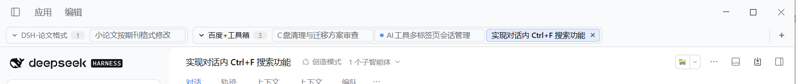
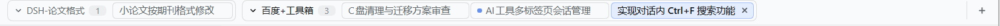
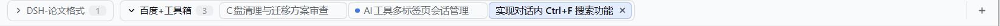
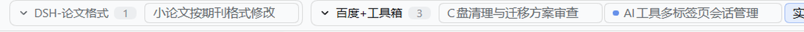

# dsh-session-tabs

**中文** · [English](README.en.md)


> 给 DSH（DeepSeek Harness）的 Web GUI 装一条**浏览器式的顶部标签栏**：一个标签 = 一个会话，同一个项目的会话收在一个可折叠的框里，点一下就切过去。左侧栏从此可以关掉，正文也能更宽。



## 为什么会有这个插件

DSH 原来靠左侧栏在会话之间跳：侧栏必须一直占着宽度，切过去还要先点开列表、再在几十行里找。这和浏览器的体验是反的——浏览器里开着的页面永远在顶部排成一排，一眼看到、一下点到，不占正文空间。

这个插件把「开着的会话」变成窗口顶部的一排标签，把「项目」变成可以收起来的框：

- 想切会话，**抬头点一下**就行，不用翻侧栏；
- 觉得侧栏碍事，**直接收起**，标签栏照样在；
- 项目太多时，把不看的项目**折叠**成一个 `项目名 3` 的小框，需要时再展开。

## 一眼看懂

**展开状态**——两个项目各一个框，框里是会话标签：



**折叠状态**——点项目名就收起来，只剩 `项目名 + 标签数`，状态会记住：



**细节**：



> 左边 `⌄ DSH-论文格式 1` 是一个项目框：`⌄` 表示已展开，`1` 是这个项目里开着的标签数，点框头即可折叠成 `›`。
> 右边是会话标签：**蓝色胶囊 + 加粗**是当前会话；标签前的小蓝点表示那个会话的 agent 正在输出；标签上的 `×` 只关闭这个标签，不删会话；最右侧 `+` 新建会话。

## 特性

- ✅ **一条整宽标签栏**，钉在窗口标题栏的正下方、从最左到最右，装上后界面整体让出 38px，不遮挡任何官方 UI。
- ✅ **一个标签 = 一个会话**：当前会话是浅蓝胶囊 + 加粗；正在输出的会话，标签前有呼吸的蓝点。
- ✅ **按项目分组、可折叠**：每个工作区一个带边框的圆角框，框头 `⌄ 项目名 + 标签数`。折叠状态保存在 `localStorage`，刷新/重启后依然是收起的。
- ✅ **标签按需创建**：只有你真正打开过的会话才会出现，不会一装就把上百个历史会话铺满；标签按打开顺序排列，对话持续输出时也不会左右乱跳。
- ✅ **`×` 只关标签，不删会话**：会话、历史、项目原封不动，回到侧栏点一下标签就回来。关掉当前标签会自动切到相邻标签；只剩一个标签时不显示 `×`（不会把标签栏关空）；中键点标签也能关。
- ✅ **`+` 新建会话**，就在标签栏最右侧。
- ✅ 标签多了自动横向滚动（在标签条上滚轮即可），两侧边缘渐隐提示还有内容。
- ✅ 当前会话被别处切走（侧栏、快捷键、深链）时，它所在的框会自动展开。
- ✅ **纯客户端、零依赖、无构建**：装完即用，不喜欢随时停用，界面立刻恢复原样。

## 安装

前提：已经装好 DSH，并且能在 Web GUI 里管理插件。

> 在 DSH 插件市场（dsh-market）里搜 `session tabs` 即可一键安装——收录申请已在 [awesome-dsh-plugin](https://github.com/awesome-dsh-plugin/awesome-dsh-plugin) 队列里，通过后市场会直接显示。在那之前用下面的方式 A。

### 方式 A：从 Release 安装（推荐，**不需要 Git**）

在 DSH 的插件管理里安装，地址填：

```
https://github.com/1834395550/dsh-session-tabs/releases/latest/download/dsh-session-tabs.tgz
```

这个地址永远指向最新版本；想固定版本就换成
`.../releases/download/v1.0.2/dsh-session-tabs-1.0.2.tgz`。

### 方式 A-2：github.com 连不上时（jsDelivr 直链）

国内网络经常连不上 `github.com`（症状：`UND_ERR_HEADERS_TIMEOUT` / `ETIMEDOUT` / 一直卡在 `HEAD https://github.com/...`）。压缩包同时放了一份在仓库根目录，由 jsDelivr CDN 分发，实测 2.5 秒装完、不需要 Git、不需要代理：

```
https://cdn.jsdelivr.net/gh/1834395550/dsh-session-tabs@main/dsh-session-tabs.tgz
```

> `@main` 会缓存约 12 小时；想确保拿到最新版，把 `@main` 换成具体提交（如 `@4cde63e`）或改用方式 A。
> 嫌麻烦还有一种**完全离线**的装法：用浏览器把上面任一 `.tgz` 下载到本地，然后在插件管理里填那个**文件的绝对路径**（如 `C:\Users\you\Downloads\dsh-session-tabs.tgz`）。

### 方式 B：从 GitHub 仓库安装（需要本机装有 Git）

```
github:1834395550/dsh-session-tabs
```

> ⚠️ 这种方式依赖本机的 `git` 命令（pnpm 要用 `git ls-remote` 解析仓库）。
> 如果报 `ERR_PNPM_GIT_RESOLVE_FAILED ... 'git' 不是内部或外部命令`，说明这台机器没装 Git —— 要么装一个 Git，要么改用**方式 A**。

### 方式 C：从本地目录安装

把仓库克隆到任意位置，然后在插件管理里安装那个**目录的绝对路径**。

装好不需要重启，标签栏立刻出现在标题栏下方。会话与标签状态都在客户端，装卸插件都不会动到你的对话数据。

## 使用

| 操作 | 效果 |
| --- | --- |
| 点标签 | 切到该会话 |
| 悬停 / 当前标签上的 `×` | 关闭这个标签（**不删会话**） |
| 中键点标签 | 同上 |
| 点 `⌄ 项目名` | 折叠 / 展开这个项目的标签 |
| 点最右的 `+` | 在当前项目新建一个会话 |
| 在标签条上滚轮 | 横向滚动 |

## 实现

- 纯客户端插件，**Host 半边是空的**，也没有构建步骤：`index.js` + `client.js` 直接就是可运行的 ESM。
- 渲染座位是 `shell.overlay`（整窗浮层）。DSH 的窗口框架没有「整窗顶部一行」的插槽，所以标签栏用固定定位贴在标题条下方，同时用一条 `:has()` 规则把框架顶下来 38px：

  ```css
  html[data-dsh-session-tabs="on"] div:has(> [data-shell-overlay]) {
    padding-top: calc(var(--dsh-windows-titlebar-height, 0px) + 38px) !important;
  }
  ```

- 数据来自客户端服务：`sessions.list`（会话与摘要）、`workspaces.list`（项目与归档状态）、`uiWorkspace.openSession(id)`（打开会话）、`uiWorkspace.startSession()`（新建会话）。
- 可见性规则与官方侧栏一致：隐藏子代理会话、非当前的空会话、已归档会话。
- 插件停用或卸载时会撤掉注入的 `<style>` 并移除根属性，界面立即恢复原样。

## 已知限制

- 在 DSH 桌面端（Windows，页面带 `data-windows-titlebar`）验证；纯浏览器窗口里没有那条原生标题条，标签栏会直接贴在窗口顶部（仍然可用）。
- 标签宽度上限 200px（CSS 变量 `--st-tab-max`），超长标题截断为 `…`。
- 至少保留一个标签；`×` 不会把标签栏关空。
- 只支持 Web 平台（`dsh.client.platform = "web"`），没有 TUI 版本。

## 开发

```bash
# 仓库本身就是一个可安装的插件目录，不需要构建
node --check client.js
```

改 `client.js` 保存后，正在运行的 DSH 会热更新，几秒内标签栏就换上新代码。

## 许可证

[MIT](LICENSE)
